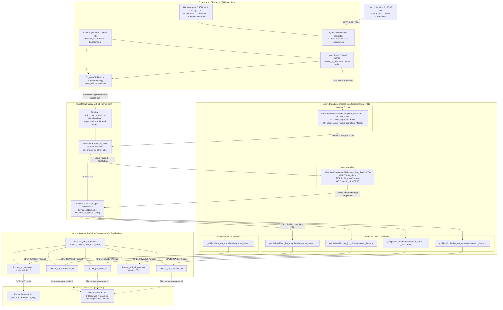

# Architektura Systemu — Polish Job Market Intelligence

Projekt realizuje zautomatyzowany, skalowalny i idempotentny proces gromadzenia oraz analizy danych polskiego rynku pracy IT w architekturze nowoczesnego jeziora danych (Modern Data Lakehouse — Medallion Architecture) w chmurze Microsoft Azure.

Dokument opisuje architekturÄ™ systemu po wdroĹĽeniu produkcyjnym **Gold v2**, z zachowaniem warstwy **Gold v1** w trybie legacy.

---

## 1. Diagram Architektury Przepływu Danych

Poniższy diagram ilustruje kompletny przepływ danych: od pobrania z zewnętrznego API do warstwy raportowania analitycznego.



---

## 2. Kontrakty Danych i Odpowiedzialność Warstw

### 2.1. Warstwa Bronze (Surowy ZbiĂłr Danych)
- **Format:** Nieskompresowane pliki JSON podzielone na strony API (`offers_page_0000.json`, `offers_page_0001.json`, ...) oraz plik kontrolny `manifest.json`.
- **ĹšcieĹĽka ADLS Gen2:** `bronze/source=solidjobs/snapshot_date=YYYY-MM-DD/run_id=<timestamp_utc>/`.
- **Reguła nienaruszalności (Audit Trail):** Dane surowe są niemodyfikowalne. Każda próba ekstrakcji otrzymuje unikalny znacznik czasu `run_id` w standardzie UTC z dokładnością do mikrosekund, co wyklucza ryzyko przypadkowego nadpisania danych historycznych.
- **Kontrakt manifestu Bronze:**
  ```json
  {
    "source": "solidjobs",
    "run_id": "20261027T100650200206Z",
    "snapshot_date": "2026-10-27",
    "started_at": "2026-10-27T10:06:50.200206+00:00",
    "status": "completed",
    "expected_offers": 1520,
    "expected_pages": 152,
    "downloaded_pages": 152,
    "downloaded_offers": 1520,
    "unique_offers": 1520,
    "finished_at": "2026-10-27T10:08:31.787027+00:00"
  }
  ```
- **Kryteria walidacji:** Status `completed` nadawany jest wyłącznie wtedy, gdy liczba pobranych stron i ofert odpowiada nagłówkom API, a liczba unikalnych identyfikatorów ofert jest równa liczbie pobranych rekordów. W przeciwnym razie manifest zapisuje status `incomplete` lub `failed` wraz z opisem błędu, a proces kończy się kodem błędu `1`.

---

### 2.2. Warstwa Silver (Oczyszczony ZbiĂłr Ustrukturyzowany)
- **Format:** Apache Parquet z kompresjÄ… Snappy.
- **ĹšcieĹĽka ADLS Gen2:** `silver/jobs/source=solidjobs/snapshot_date=YYYY-MM-DD/run_id=<run_id>/`.
- **Silnik przetwarzania:** Apache Spark w Azure Synapse Analytics (`nb_bronze_to_silver_jobs`) na puli `sparkjobmarket`.
- **Transformacje i reguły jakościowe:**
  - Rozpakowanie zagnieĹĽdĹĽonych struktur JSON ze stron surowych.
  - Spłaszczenie i typowanie atrybutów: identyfikatory, daty ważności i publikacji, wymiar czasu umowy.
  - Normalizacja widełek płacowych (`salary.from`, `salary.to`, `salary.currency`, `salary.period`, `salary.employmentType`).
  - Znakowanie flag jakości danych (`quality_flags`) i deduplikacja ogłoszeń w obrębie danego snapshotu.
  - Zwieńczenie pomyślnego zapisu partycji znacznikiem `_SUCCESS`.

---

### 2.3. Warstwa Gold v2 (Aktywny Model Analityczny Gwiazdy)
Warstwa Gold v2 została zaimplementowana w notatniku `nb_silver_to_gold_v2_jobs` jako model gwiazdy z rozbiciem tablic na tabele pomostowe (bridge tables).

- **ĹšcieĹĽka bazowa:** `gold/jobs/v2/`.
- **Partycjonowanie:** Wszystkie zbiory są partycjonowane ściśle według **`snapshot_date=YYYY-MM-DD`**.
- **Fizyczne tabele biznesowe i manifest:**

```
gold/jobs/v2/
├── fact_job_snapshots/
│   └── snapshot_date=YYYY-MM-DD/
│       ├── part-*.parquet
│       └── _SUCCESS
├── bridge_job_skills/
│   └── snapshot_date=YYYY-MM-DD/
│       ├── part-*.parquet
│       └── _SUCCESS
├── bridge_job_locations/
│   └── snapshot_date=YYYY-MM-DD/
│       ├── part-*.parquet
│       └── _SUCCESS
└── _manifest/
    └── snapshot_date=YYYY-MM-DD/
        ├── part-*.parquet
        └── _SUCCESS
```

#### Tabela 1: `fact_job_snapshots`
Główna tabela faktów przechowująca pojedyncze ogłoszenia o pracę w ujęciu danego snapshotu dziennego.
- `job_snapshot_key` (STRING, klucz główny migawki)
- `source` (STRING, np. `solidjobs`)
- `job_id` (STRING, identyfikator ogłoszenia ze źródła `jobOfferKey`)
- `run_id` (STRING, identyfikator wykonania)
- `title` (STRING, tytuł stanowiska)
- `division` (STRING, dział)
- `category` (STRING, kategoria główna)
- `sub_category` (STRING, podkategoria)
- `company` (STRING, nazwa firmy)
- `company_logo_url` (STRING, URL do logotypu)
- `experience_level` (STRING, poziom doświadczenia)
- `salary_from` (DOUBLE / DECIMAL, dolna granica wynagrodzenia)
- `salary_to` (DOUBLE / DECIMAL, gĂłrna granica wynagrodzenia)
- `salary_currency` (STRING, waluta)
- `salary_period` (STRING, okres rozliczeniowy)
- `employment_type` (STRING, forma współpracy, np. B2B, UoP)
- `is_remote` (BOOLEAN, praca w pełni zdalna)
- `is_hybrid` (BOOLEAN, praca hybrydowa)
- `contract_time` (STRING, wymiar etatu)
- `valid_from` (STRING / TIMESTAMP)
- `valid_to` (STRING / TIMESTAMP)
- `updated_at` (STRING / TIMESTAMP)
- `url` (STRING, link do oferty)
- `languages_json` (STRING, serializowana tablica języków)
- `benefits_json` (STRING, serializowana tablica benefitĂłw)

#### Tabela 2: `bridge_job_skills`
Tabela pomostowa mapująca umiejętności techniczne oraz kompetencje miękkie powiązane z ofertą.
- `job_snapshot_key` (STRING, klucz obcy do tabeli faktĂłw)
- `job_id` (STRING, identyfikator ogłoszenia)
- `run_id` (STRING, identyfikator wykonania)
- `skill_index` (INTEGER, indeks pozycji umiejętności w ogłoszeniu uzyskany przez `posexplode_outer`)
- `skill_name` (STRING, nazwa technologii lub kompetencji miękkiej)
- `skill_level` (STRING, wymagany poziom biegłości)

#### Tabela 3: `bridge_job_locations`
Tabela pomostowa normalizujÄ…ca lokalizacje przypisane do oferty pracy.
- `job_snapshot_key` (STRING, klucz obcy do tabeli faktĂłw)
- `job_id` (STRING, identyfikator ogłoszenia)
- `run_id` (STRING, identyfikator wykonania)
- `location_index` (INTEGER, indeks pozycji lokalizacji w ogłoszeniu uzyskany przez `posexplode_outer`)
- `location_name` (STRING, znormalizowana nazwa miasta / lokalizacji)

#### Tabela 4 (Manifest ETL): `_manifest`
Struktura techniczna stanowiÄ…ca jedyny ostateczny znacznik poprawnego zatwierdzenia snapshotu w Gold v2.
- `snapshot_date` (STRING, data snapshotu)
- `run_id` (STRING, zatwierdzony identyfikator wykonania)
- `job_count` (LONG, liczba ofert w tabeli faktĂłw)
- `skill_count` (LONG, liczba powiązań w tabeli umiejętności)
- `location_count` (LONG, liczba powiązań w tabeli lokalizacji)

---

### 2.4. Relacje Między Tabelami Gold v2

Relacje logiczne i fizyczne opierajÄ… siÄ™ na kluczu syntetycznym `job_snapshot_key`:

```
               +--------------------------------------+
               |          fact_job_snapshots          |
               +--------------------------------------+
               | PK  job_snapshot_key                 |
               |     source, job_id, run_id           |
               |     title, company, salary_from ...  |
               +--------------------------------------+
                                  │
                 ┌────────────────┴────────────────┐
            1:N  │                            1:N  │
                 â–Ľ                                 â–Ľ
+---------------------------------+  +-----------------------------------+
|        bridge_job_skills        |  |       bridge_job_locations        |
+---------------------------------+  +-----------------------------------+
| FK  job_snapshot_key            |  | FK  job_snapshot_key              |
|     job_id, run_id              |  |     job_id, run_id                |
| PK  skill_index                 |  | PK  location_index                |
|     skill_name, skill_level     |  |     location_name                 |
+---------------------------------+  +-----------------------------------+
```

- **Format klucza głównego:** `job_snapshot_key` = `solidjobs|{snapshot_date}|{jobOfferKey}`.
- **Kardynalność:** Jedna oferta w tabeli faktów posiada wiele rekordów w `bridge_job_skills` oraz wiele w `bridge_job_locations`.
- **Klucz złożony tabel pomostowych:** Unikalność każdego wiersza w tabelach pomostowych wyznaczają pary: `(job_snapshot_key, skill_index)` oraz `(job_snapshot_key, location_index)`.

---

### 2.5. Warstwa Gold v1 (Legacy)
- **ĹšcieĹĽka ADLS Gen2:** `gold/jobs/fact_job_snapshots/snapshot_date=YYYY-MM-DD/`.
- **Status:** Warstwa historyczna (legacy). Notatnik `nb_silver_to_gold_jobs` pozostaje w repozytorium jako referencyjny.
- **Rola biznesowa:** Zachowuje ciągłość działania istniejącego raportu Power BI v1 do czasu wdrożenia raportu Power BI v2.

---

## 3. Idempotentność, Walidacja i Mechanizm Zapisu w Gold v2

Proces przetwarzania w notatniku `nb_silver_to_gold_v2_jobs` został zaprojektowany z rygorystycznymi gwarancjami spójności:

### 1. Detekcja stanu i idempotencja:
- Notatnik sprawdza obecność znacznika `_SUCCESS` w katalogu `_manifest/snapshot_date=YYYY-MM-DD/` oraz we wszystkich trzech tabelach.
- JeĹĽeli manifest istnieje i wszystkie tabele posiadajÄ… `_SUCCESS`, data jest bezpiecznie **pomijana** (`skipped_dates`).

### 2. Ochrona przed nadpisywaniem częściowych danych:
- Jeżeli katalog którejkolwiek z trzech tabel lub katalog `_manifest` istnieje fizycznie w ADLS, ale brak jest poprawnego manifestu ze znacznikiem `_SUCCESS`, notatnik **przerywa działanie z błędem (`RuntimeError: częściowy Gold v2 ..., brak manifestu. Nie nadpisuję!`)**.
- Zapobiega to cichemu uszkodzeniu lub nadpisaniu danych w przypadku wcześniejszej awarii zadania Spark. Wymagana jest manualna weryfikacja.

### 3. Weryfikacja jakości przed zapisem (Pre-write Quality Gates):
Przed fizycznym utrwaleniem na storage weryfikowane sÄ… warunki:
- `job_count > 0` oraz brak pustych/null wartości w `job_id`.
- Całkowity brak duplikatów `job_snapshot_key` w tabeli faktów.
- Zgodność parametru `run_id` we wszystkich wierszach z wybranym wykonaniem.
- Integralność eksplodowanych tablic: `expected_skills == skill_count` oraz `expected_locations == location_count`.
- Brak osieroconych rekordów relacyjnych (`anti-join` między dziećmi a `fact_job_snapshots` musi zwrócić 0 wierszy).
- Brak brakujÄ…cych lub zduplikowanych indeksĂłw `skill_index` i `location_index`.

### 4. Kontrolowana sekwencja zapisu z manifestem zatwierdzenia:
1. Zapis tabeli `fact_job_snapshots` w trybie `.mode("errorifexists")` i sprawdzenie istnienia `_SUCCESS`.
2. Zapis tabeli `bridge_job_skills` w trybie `.mode("errorifexists")` i sprawdzenie istnienia `_SUCCESS`.
3. Zapis tabeli `bridge_job_locations` w trybie `.mode("errorifexists")` i sprawdzenie istnienia `_SUCCESS`.
4. Dopiero **PO** poprawnym zapisaniu i zweryfikowaniu wszystkich trzech tabel, generowany i zapisywany jest zbiĂłr `_manifest` w trybie `.mode("errorifexists")`.
5. Weryfikacja pliku `_manifest/_SUCCESS`.

---

## 4. Warstwa Prezentacji Analitycznej (Synapse Serverless SQL)

Do udostępniania danych analitykom i narzędziom BI bez ponoszenia kosztów dedykowanych baz danych w stanie bezczynności wykorzystywana jest pula **Synapse Serverless SQL (Built-in)**.

- **Baza danych:** `job_market`
- **Kodowanie:** `Latin1_General_100_BIN2_UTF8` (pełna obsługa polskich znaków diakrytycznych)
- **Skrypt wdroĹĽeniowy:** `synapse/sqlscript/03_create_gold_v2_views.json`

### Aktywne widoki Gold v2:
1. **`dbo.vw_job_snapshots_v2`:**
   ```sql
   CREATE OR ALTER VIEW dbo.vw_job_snapshots_v2 AS
   SELECT
       REPLACE(jobs.filepath(1), 'snapshot_date=', '') AS snapshot_date,
       jobs.*
   FROM OPENROWSET(
       BULK 'https://stjobmarketdev01.dfs.core.windows.net/gold/jobs/v2/fact_job_snapshots/snapshot_date=*/*.parquet',
       FORMAT = 'PARQUET'
   ) AS jobs;
   ```
2. **`dbo.vw_job_skills_v2`:**
   ```sql
   CREATE OR ALTER VIEW dbo.vw_job_skills_v2 AS
   SELECT
       REPLACE(skills.filepath(1), 'snapshot_date=', '') AS snapshot_date,
       skills.*
   FROM OPENROWSET(
       BULK 'https://stjobmarketdev01.dfs.core.windows.net/gold/jobs/v2/bridge_job_skills/snapshot_date=*/*.parquet',
       FORMAT = 'PARQUET'
   ) AS skills;
   ```
3. **`dbo.vw_job_locations_v2`:**
   ```sql
   CREATE OR ALTER VIEW dbo.vw_job_locations_v2 AS
   SELECT
       REPLACE(locations.filepath(1), 'snapshot_date=', '') AS snapshot_date,
       locations.*
   FROM OPENROWSET(
       BULK 'https://stjobmarketdev01.dfs.core.windows.net/gold/jobs/v2/bridge_job_locations/snapshot_date=*/*.parquet',
       FORMAT = 'PARQUET'
   ) AS locations;
   ```
4. **`dbo.vw_gold_v2_commits` (Manifest ETL):**
   ```sql
   CREATE OR ALTER VIEW dbo.vw_gold_v2_commits AS
   SELECT
       manifest.snapshot_date,
       manifest.run_id,
       manifest.job_count,
       manifest.skill_count,
       manifest.location_count
   FROM OPENROWSET(
       BULK 'https://stjobmarketdev01.dfs.core.windows.net/gold/jobs/v2/_manifest/snapshot_date=*/*.parquet',
       FORMAT = 'PARQUET'
   ) AS manifest;
   ```

### Widok legacy Gold v1:
- **`dbo.vw_job_snapshots`:** Zdefiniowany w `sql/02_create_view_job_snapshots.sql`, czyta ścieżkę `gold/jobs/fact_job_snapshots/` i zasila dotychczasowy raport Power BI v1.

> [!IMPORTANT]
> **Mechanizm weryfikacji kompletności w Synapse Serverless SQL:**
> Silnik Serverless SQL czyta pliki Parquet za pomocą `OPENROWSET` z wieloznacznikiem ścieżki (`snapshot_date=*/*.parquet`). Samodzielnie **nie sprawdza fizycznego pliku `_SUCCESS`**.
> Zapytania analityczne, procedury walidacyjne oraz zasilanie raportów filtrują lub łączą dane z widokiem manifestu `dbo.vw_gold_v2_commits`, co gwarantuje odczyt wyłącznie snapshotów zatwierdzonych przez ETL.

---

## 5. Orkiestracja i Monitoring Operacyjny

### 5.1. Różnica między uruchomieniem potoku a jego zakończeniem (Asynchroniczność ADF)
Dzienny potok ETL jest wyzwalany automatycznie przez GitHub Actions (`.github/workflows/daily_extract.yml`):
- **Nazwa workflow:** `Job Market - Daily ETL (Azure)`.
- **Harmonogram:** `cron: "40 4 * * *"` w strefie UTC (brak parametru timezone w składni GitHub Actions; uruchomienie następuje o 05:40 czasu warszawskiego zimą oraz o 06:40 latem).
- **Asynchroniczność ADF:** Skrypt `src/trigger_adf.py` wywołuje pipeline w Azure Data Factory za pomocą metody `client.pipelines.create_run`. Jest to wywołanie typu **fire-and-forget**. Usługa ADF przyjmuje zlecenie, zwraca unikalny `Pipeline Run ID`, a skrypt w GitHub Actions kończy działanie z kodem `0`.
- **Konsekwencja operacyjna:**
  - **Sukces workflow GitHub Actions (zielony status) NIE gwarantuje sukcesu pipeline'u ADF.** Potwierdza on wyłącznie poprawne pobranie ofert, upload surowego JSON do Bronze oraz skuteczne zlecenie wykonania w ADF.
  - Faktyczne zadania Apache Spark (`nb_bronze_to_silver_jobs` oraz `nb_silver_to_gold_v2_jobs`) wykonujÄ… siÄ™ na klastrze Synapse przez kolejne minuty.

### 5.2. Strategia monitoringu operacyjnego
Zgodnie z koncepcjÄ… opisanÄ… w [docs/operational_monitoring.md](docs/operational_monitoring.md):
1. **GitHub Actions Logs:** Weryfikacja krokĂłw ekstrakcji, liczby pobranych stron i ofert, sum kontrolnych uploadu do Bronze oraz identyfikatora uruchomienia ADF.
2. **Azure Data Factory Studio (zakładka Monitor):** Bieżące śledzenie statusów aktywności `Bronze_to_silver` oraz `SIlver_to_gold`.
3. **Azure Monitor Alerts:** Zalecana konfiguracja reguł alertów Azure Monitor opartych o tabelę `ADFPipelineRun` wysyłających powiadomienia w razie statusu `Failed`, bez obciążania runnerów CI/CD długim czasem oczekiwania.

---

## 6. Wyniki Walidacji WdroĹĽeniowej (Rollout Audit)

> [!NOTE]
> Poniższa tabela zawiera **statyczne dane audytowe** z walidacji wdrożeniowej architektury Gold v2, przeprowadzonej w dniach 26–29 października 2026 r. Dane te mają charakter referencyjnego audytu powdrożeniowego i **nie są aktualizowane automatycznie**.

| Data snapshotu (`snapshot_date`) | Oferty pracy (`fact_job_snapshots`) | Umiejętności (`bridge_job_skills`) | Lokalizacje (`bridge_job_locations`) | Status walidacji |
|:---:|:---:|:---:|:---:|:---:|
| **2026-10-26** | 1 538 | 10 221 | 1 538 | Zgodny (OK) |
| **2026-10-27** | 1 520 | 10 042 | 1 520 | Zgodny (OK) |
| **2026-10-28** | 1 525 | 10 085 | 1 525 | Zgodny (OK) |
| **2026-10-29** | 1 537 | 10 152 | 1 537 | Zgodny (OK) |

Wszystkie snapshoty zostały zweryfikowane pod kątem braku duplikatów identyfikatorów, zerowej liczby rekordów osieroconych oraz spójności sum kontrolnych z manifestem ETL.

---

## 7. Bezpieczeństwo i Architektura Bezhasłowa (OIDC)

W środowisku wdrożono bezhasłową federację tożsamości z Microsoft Entra ID:
- Workflow CI (`.github/workflows/ci.yml`) działa w trybie tylko do odczytu kodu (`contents: read`) i nie posiada dostępu do żadnych zasobów chmurowych.
- Workflow dziennego ETL (`.github/workflows/daily_extract.yml`) korzysta z tokenu OIDC (`id-token: write`) powiązanego z gałęzią `main`.
- Uprawnienia Azure RBAC tożsamości ograniczone są ściśle do kontenera `bronze` w storage account `stjobmarketdev01` oraz wyzwalania pipeline'u `pl_job_market_daily_etl`.
- Dostęp Power BI do bazy Synapse Serverless SQL realizowany jest poprzez dedykowanego użytkownika Entra ID `powerbi-reader@adamablergmail.onmicrosoft.com` z uprawnieniem `GRANT SELECT` wyłącznie do wymaganych widoków.

Szczegółowy opis decyzji architektonicznej znajduje się w dokumencie [docs/adr/0002-passwordless-github-oidc-security.md](adr/0002-passwordless-github-oidc-security.md).
